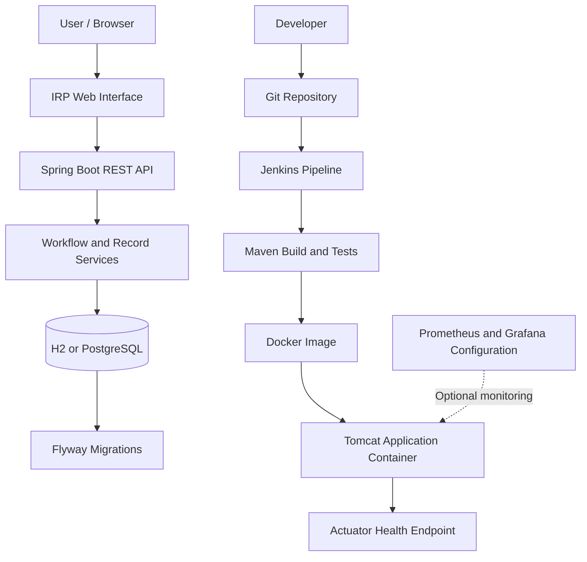

# Institutional Repository Portal (IRP) — DevOps Platform

A containerized institutional repository application demonstrating a Java web application workflow alongside automated testing, database migrations, containerization, CI/CD, configuration management, and monitoring.

**Developed by Nilesh Patni** · B.Tech Computer Engineering
**Institute:** Vidyalankar Institute of Technology
**University:** University of Mumbai

---

## Table of Contents

- [Overview](#overview)
- [Key Features](#key-features)
- [Technology Stack](#technology-stack)
- [Architecture](#architecture)
- [Repository Structure](#repository-structure)
- [Prerequisites](#prerequisites)
- [Quick Start](#quick-start)
- [PostgreSQL Setup](#postgresql-setup)
- [Local Development](#local-development)
- [Testing](#testing)
- [Jenkins CI/CD](#jenkins-cicd)
- [Monitoring](#monitoring)
- [Ansible](#ansible)
- [API Reference](#api-reference)
- [Configuration and Security](#configuration-and-security)
- [Troubleshooting](#troubleshooting)
- [Project Documentation](#project-documentation)
- [Author](#author)
- [Disclaimer](#disclaimer)

---

## Overview

The Institutional Repository Portal (IRP) is a Java-based web application for managing academic and institutional repository records.

The application demonstrates a record lifecycle in which submitters create records, reviewers approve or reject submissions, and administrators publish approved records. Users can search records and view dashboard summaries.

The project combines application development with DevOps practices to demonstrate repeatable builds, containerized execution, database persistence, automated testing, and deployment-related tooling.

### Project Objectives

- Develop a repository management web application.
- Implement record management and workflow transitions.
- Package the application as a deployable WAR.
- Run the application in Docker containers.
- Support H2 and PostgreSQL database configurations.
- Manage database schema changes with Flyway.
- Automate build and verification with Maven.
- Exercise browser workflows using Selenium.
- Demonstrate Jenkins pipelines, Ansible configuration management, and monitoring configuration.

## Key Features

- **Repository management:** Create, update, search, and list repository records.
- **Workflow management:** Demonstrate record states including Draft, Submitted, Approved, Published, and Rejected.
- **Dashboard:** Summarize records by status and department.
- **REST API:** Expose endpoints for record operations, workflow transitions, dashboard data, and health information.
- **Database migrations:** Use Flyway migration scripts to manage schema changes and seed records.
- **Containerization:** Build and run the application using Docker and Docker Compose.
- **Database options:** Use H2 for a lightweight local setup or PostgreSQL for a relational database service.
- **Automated testing:** Include JUnit/MockMvc application tests and Selenium browser journeys.
- **CI/CD demonstration:** Include a Jenkinsfile and Jenkins pipeline configuration.
- **Operations tooling:** Include Ansible playbooks, monitoring configuration, runbooks, and verification scripts.

> **Authentication note:** The current role-selection workflow uses an `X-Role` header. It demonstrates application workflow permissions and is not a production authentication system. Production deployment would require proper identity management, authorization enforcement, secret management, and security hardening.

## Technology Stack

| Area | Technologies |
|---|---|
| Language | Java 17 |
| Application framework | Spring Boot 3 |
| Web runtime | Apache Tomcat 10.1 |
| Build | Apache Maven |
| Database | H2, PostgreSQL 16 |
| Database migrations | Flyway |
| Containerization | Docker, Docker Compose |
| CI/CD | Jenkins, Jenkinsfile |
| Application testing | JUnit, Spring MockMvc |
| Browser automation | Selenium, JUnit Jupiter |
| Configuration management | Ansible |
| Monitoring | Prometheus, Grafana |
| Version control | Git, GitHub |

## Architecture



The diagram describes the project's intended component relationships. The Jenkins job configured locally has been executed successfully, but the local job currently uses an inline pipeline script rather than Git-based checkout. The complete automated Git-to-deployment flow should be validated separately before being described as fully operational.

## Repository Structure

```text
irp-devops-platform/
├── .github/
│   ├── ISSUE_TEMPLATE/
│   └── PULL_REQUEST_TEMPLATE.md
├── ansible/
│   ├── group_vars/
│   ├── inventory.ini
│   ├── requirements.yml
│   └── site.yml
├── demo/
│   ├── index.html
│   └── mock-api.js
├── docs/
│   ├── 01-problem-scope.md
│   ├── 02-agile-plan.md
│   ├── 03-architecture.md
│   ├── PRESENTATION-PLAN.md
│   ├── RUNBOOK.md
│   ├── SETUP-WINDOWS.md
│   ├── TASK-CHECKLIST.md
│   └── VIVA-GUIDE.md
├── evidence/
├── monitoring/
│   ├── grafana-datasource.yml
│   └── prometheus.yml
├── scripts/
│   ├── build-demo.py
│   ├── docker-lifecycle.ps1
│   ├── git-conflict-demo.ps1
│   ├── run-local.ps1
│   └── verify-tasks.py
├── selenium-tests/
│   ├── pom.xml
│   └── src/test/java/
├── src/
│   ├── main/
│   │   ├── java/
│   │   └── resources/
│   └── test/
│       └── java/
├── .dockerignore
├── .gitignore
├── Dockerfile
├── Jenkinsfile
├── docker-compose.yml
├── docker-compose.postgres.yml
└── pom.xml
```

Generated Maven output under `target/` is excluded from version control.

## Prerequisites

For the Windows development environment:

- Git
- JDK 17 or a compatible configured Java environment
- Apache Maven
- Docker Desktop with the Linux container engine
- A modern browser for manual testing
- Chrome and a compatible Selenium setup for browser automation

Jenkins, Ansible, and monitoring tools are needed only for their respective workflows. Refer to `docs/SETUP-WINDOWS.md` for detailed setup guidance.

## Quick Start

### Option 1: Run with Docker Compose

From the repository root:

```powershell
docker compose up -d --build
```

Open the application:

- Portal: http://localhost:8080
- Health check: http://localhost:8080/actuator/health

Inspect running services:

```powershell
docker compose ps
docker compose logs -f portal
```

Stop the application:

```powershell
docker compose down
```

The default Compose configuration uses persistent H2 storage through the `irp-data` named volume.

### Option 2: Build and verify with Maven

Ensure Java and Maven are installed:

```powershell
java -version
mvn -version
```

Build and run the project's verification lifecycle:

```powershell
mvn -B clean verify
```

To run the application locally, consult `docs/SETUP-WINDOWS.md` and `scripts/run-local.ps1`.

## PostgreSQL Setup

The PostgreSQL Compose configuration provides a PostgreSQL 16 service and a portal container.

Start both services:

```powershell
docker compose -f docker-compose.postgres.yml up -d --build
```

By default, the portal is exposed on port `8080`. If that port is occupied, set a different host port before starting the stack:

```powershell
$env:HTTP_PORT = "8081"
docker compose -f docker-compose.postgres.yml up -d --build
```

Check the services:

```powershell
docker compose -f docker-compose.postgres.yml ps
```

Check PostgreSQL readiness:

```powershell
docker exec irp-postgres pg_isready -U irp -d irp
```

Open the portal using the host port selected above.

### Database configuration

The default local-development configuration uses:

| Setting | Default |
|---|---|
| Database | `irp` |
| Database user | `irp` |
| Database container port | `5432` |
| Host portal port | `8080` |
| Database image | `postgres:16-alpine` |

The default Compose password is intended only for local development. Supply a strong, private password through the `POSTGRES_PASSWORD` environment variable before running a public or shared deployment.

Stop the PostgreSQL stack:

```powershell
docker compose -f docker-compose.postgres.yml down
```

The named database volume is retained by this command. To delete local database data as well, use `docker compose -f docker-compose.postgres.yml down -v` only when you deliberately want to remove it.

## Local Development

The main Maven project is defined in `pom.xml`. Application source code, resources, database migrations, and tests are located under `src/`.

Important resource files include:

- `src/main/resources/application.properties`
- `src/main/resources/application-postgres.properties`
- `src/main/resources/db/migration/`

The PostgreSQL Compose service and the application are configured to use the `irp` database. Review the environment-specific properties and setup guide before changing database configuration.

## Testing

### Maven verification

Run from the repository root:

```powershell
mvn -B clean verify
```

This executes the Maven verification lifecycle, including the tests configured for the project.

### Selenium browser tests

First ensure the application is running. The PostgreSQL portal used in local testing was exposed on port `8081`.

From the repository root:

```powershell
cd selenium-tests
mvn -B test "-Dbase.url=http://localhost:8081"
```

For a visible browser, where supported by the test configuration:

```powershell
mvn -B test "-Dbase.url=http://localhost:8081" "-Dheadless=false"
```

The Selenium test module uses its own `pom.xml`. Check its Surefire reports for the actual test count, failures, errors, and skipped tests.

### Test reporting

Useful output locations include:

- `target/surefire-reports/`
- `target/site/jacoco/`
- `selenium-tests/target/surefire-reports/`
- `selenium-tests/target/screenshots/`

These are generated outputs; keep them out of source control unless selected evidence is deliberately copied into `evidence/`.

## Jenkins CI/CD

The repository includes a `Jenkinsfile` intended to describe pipeline automation.

Jenkins was installed locally and a pipeline job was executed successfully using an inline pipeline script that ran Java/Maven environment checks and `mvn -B clean verify` against the local project directory.

This verifies a local Jenkins build. It does not, by itself, demonstrate automatic Git checkout, webhook-triggered execution, image publishing, or automated deployment.

### Suggested next CI/CD improvements

1. Configure Jenkins to check out this repository from Git.
2. Use the repository's `Jenkinsfile` as the pipeline definition.
3. Run Maven verification on each commit.
4. Publish test reports and selected build artifacts.
5. Add image publishing only after configuring credentials securely.
6. Add deployment stages only after the target environment and rollback procedure are tested.

Do not commit Jenkins passwords, API tokens, private keys, or credential files.

## Monitoring

Optional monitoring services are defined in `docker-compose.yml` under the `monitoring` profile.

Start the configured stack:

```powershell
docker compose --profile monitoring up -d --build
```

Default local endpoints:

- Prometheus: http://localhost:9091
- Grafana: http://localhost:3000

Review `monitoring/prometheus.yml` and `monitoring/grafana-datasource.yml` to confirm the scrape targets and datasource configuration for your running environment.

Monitoring is optional. Verify the services and dashboards before claiming that live metrics are being collected.

## Ansible

The `ansible/` directory contains configuration-management and deployment-related files, including:

- `site.yml`
- `inventory.ini`
- `requirements.yml`
- `group_vars/all.yml`

The included setup guide and runbook describe the intended operational workflow. On Windows, Ansible generally requires a suitable Linux environment such as WSL2.

Review the inventory and variables before running playbooks. Do not place real passwords, private keys, or production credentials in tracked files.

## API Reference

The following endpoints are documented by the application README and controller structure.

| Method | Endpoint | Purpose |
|---|---|---|
| GET | `/api/records?q=&status=` | Search and list records |
| POST | `/api/records` | Create a record |
| PUT | `/api/records/{id}` | Update an editable record |
| POST | `/api/records/{id}/transition` | Request a workflow transition |
| GET | `/api/dashboard` | Retrieve dashboard summaries |
| GET | `/api/info` | Retrieve application information |
| GET | `/actuator/health` | Check application health |

The actual permitted transitions and validation rules are defined in the application code. Consult the controllers, workflow service, and project documentation for implementation details.

## Configuration and Security

- Do not commit `.env` files containing real secrets.
- Keep passwords, tokens, SSH keys, and certificates out of Git.
- Use environment variables or an appropriate secret-management system for sensitive settings.
- Replace the default PostgreSQL development password before shared use.
- Avoid exposing database ports to untrusted networks.
- Configure authentication and authorization before production deployment.
- Review dependencies and container images for security updates.
- Do not publish personal data or sensitive screenshots in `evidence/`.

The `.gitignore` excludes common generated files, environment files, and local artifacts. Review the actual staged file list before each public push.

## Troubleshooting

### Port 8080 is already in use

Set a different host port before starting the relevant Compose configuration:

```powershell
$env:HTTP_PORT = "8081"
docker compose -f docker-compose.postgres.yml up -d --build
```

### PostgreSQL is not ready

```powershell
docker compose -f docker-compose.postgres.yml ps
docker logs irp-postgres
docker exec irp-postgres pg_isready -U irp -d irp
```

### Maven build fails

```powershell
java -version
mvn -version
mvn -B clean verify
```

Read the first meaningful compilation or test error in the Maven output.

### Selenium cannot connect to the portal

Confirm the portal is running and use the correct host URL:

```powershell
Test-NetConnection localhost -Port 8081
```

Change `8081` to the actual port used by your running portal.

### Jenkins build fails

Open the relevant Jenkins job, select the failed build, and inspect **Console Output**. Verify the Java/Maven environment and the project path configured in the pipeline.

## Project Documentation

Additional project resources:

- [Windows Setup Guide](docs/SETUP-WINDOWS.md)
- [Architecture Documentation](docs/03-architecture.md)
- [Project Runbook](docs/RUNBOOK.md)
- [Task Checklist](docs/TASK-CHECKLIST.md)
- [Presentation Plan](docs/PRESENTATION-PLAN.md)
- [Viva Preparation Guide](docs/VIVA-GUIDE.md)
- [Evidence Directory Guide](evidence/README.md)

## Author

**Nilesh Patni**
B.Tech Computer Engineering
Vidyalankar Institute of Technology
University of Mumbai

Interested in software development, Java applications, databases, containerization, automated testing, and DevOps engineering.

Add your verified profiles when ready:

- GitHub: `https://github.com/NileshPatni123`
- LinkedIn: Add your LinkedIn profile URL
- Email: Add a professional contact email if you want it public

## Disclaimer

This is an academic and portfolio project intended to demonstrate application development and DevOps concepts. Configuration, authentication, monitoring, and deployment must be reviewed and hardened before any production use.

---

If you find an issue or have a suggestion, use the repository's GitHub issue templates.
