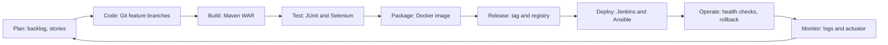

# Task 2: Agile planning and DevOps workflow

## User stories and acceptance criteria
| ID | Story | Acceptance criteria |
|---|---|---|
| US1 | As a submitter I create a record so that it enters review | Title and authors required; saved as Draft; appears in list |
| US2 | As a submitter I edit a Draft or Rejected record | Edit allowed only in those states; version number increases |
| US3 | As a submitter I submit a Draft | Status becomes Submitted; only Submitter or Admin may do this |
| US4 | As a reviewer I approve or reject a submission | Only Reviewer or Admin; status updates immediately |
| US5 | As an admin I publish an approved record | Only Admin; Published records are locked |
| US6 | As a reader I search records | Matches title, author, keyword, department; friendly empty message |
| US7 | As staff I see a dashboard | Counts per status match the table |
| US8 | As DevOps I want every commit built and tested | Jenkins job triggers on commit; JUnit report published |
| US9 | As DevOps I want one-command containers | `docker compose up` serves the portal |
| US10 | As DevOps I want repeatable server setup | Ansible run twice shows no changes; rollback restores previous version |

## Backlog and task board (14 course tasks)
| Sprint | Tasks | Board column when finished |
|---|---|---|
| Sprint 1 (Planning and setup) | 1 Problem scope, 2 Agile plan, 3 Architecture and setup, 4 GitHub repository | Done |
| Sprint 2 (Build the product) | 5 Feature 1 with PR, 6 MVP completion, conflict and tag | Done |
| Sprint 3 (Automate) | 7 Jenkins CI, 8 Jenkinsfile and Tomcat deploy, 9 Selenium, 10 Continuous testing | Done |
| Sprint 4 (Containers and operations) | 11 Docker lifecycle, 12 Jenkins to Docker CD, 13 Ansible, 14 Provisioning and rollback | Done |

Columns: Backlog, In progress, In review, Testing, Done. Use a GitHub Project board with these columns and attach each issue to a task number.

## Definition of Done
Code merged by pull request after review; `mvn clean verify` green; Selenium journeys green where UI changed; acceptance criteria demonstrated; documentation and evidence updated; no known blocking defects.

## DevOps lifecycle

