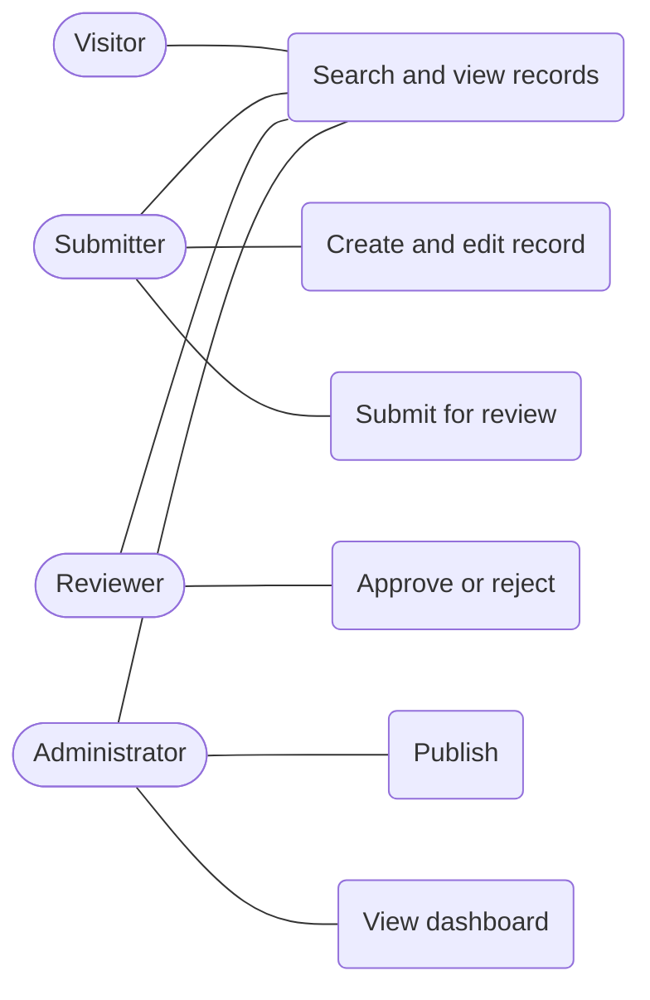
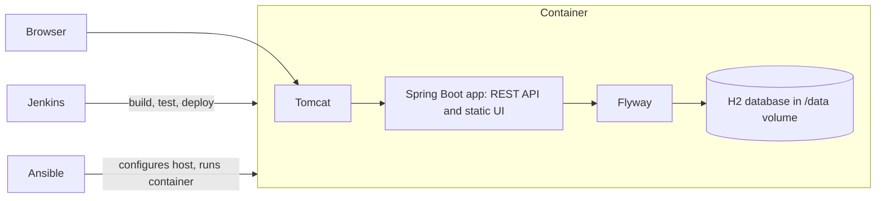
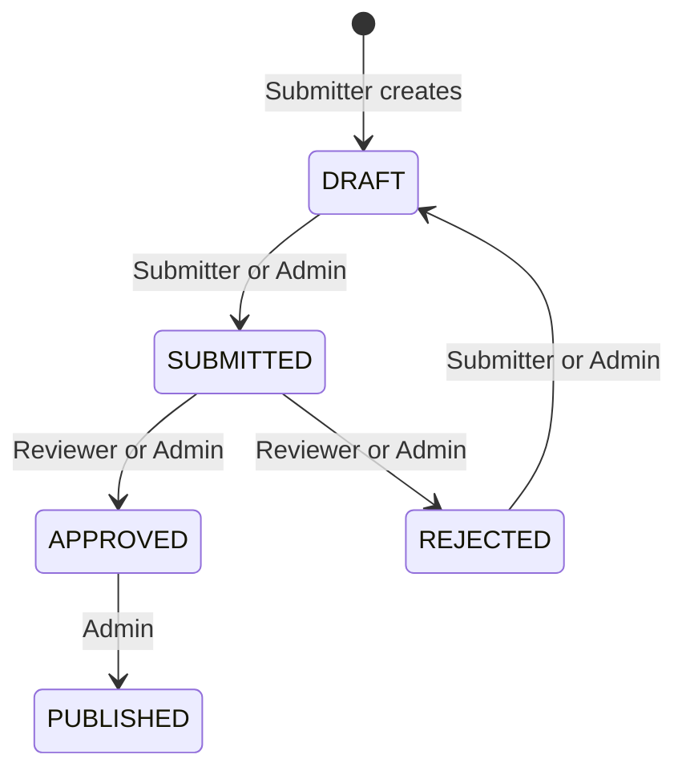

# Task 3: Requirements, architecture and technology

## SRS summary
**Functional:** create, view, edit and search records; role-based workflow Draft, Submitted, Approved or Rejected, Published; dashboard with counts by status and department.
**Non-functional:** starts in under a minute; health endpoint; reproducible build; deployable to Tomcat and as a container; configuration through environment variables; no secrets in the repository.

## Technology choices
| Concern | Choice | Reason |
|---|---|---|
| Language and framework | Java 17, Spring Boot 3.3 | Standard for Tomcat WAR deployment |
| Build | Maven | Required by tasks; used by Jenkins |
| Database | H2 (file in container, in memory locally) with Flyway migrations | Zero setup; schema versioned |
| Deployment target | Tomcat 10.1 (WAR as ROOT) | Task 8 |
| UI | Static HTML and JavaScript served by the app | No separate front-end build |
| Tests | JUnit 5, MockMvc, Selenium 4 | Tasks 9 and 10 |
| CI/CD | Jenkins, Docker | Tasks 7, 8, 12 |
| Configuration management | Ansible | Tasks 13, 14 |

## Use cases

## Architecture

## Data model
`repository_records(id, title, authors, abstract_text, record_type, department, publication_year, keywords, status, handle_id, version_no, created_at, updated_at)`

## Status workflow

The API table is in the [README](../README.md#api-summary).
